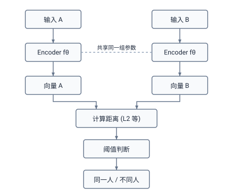
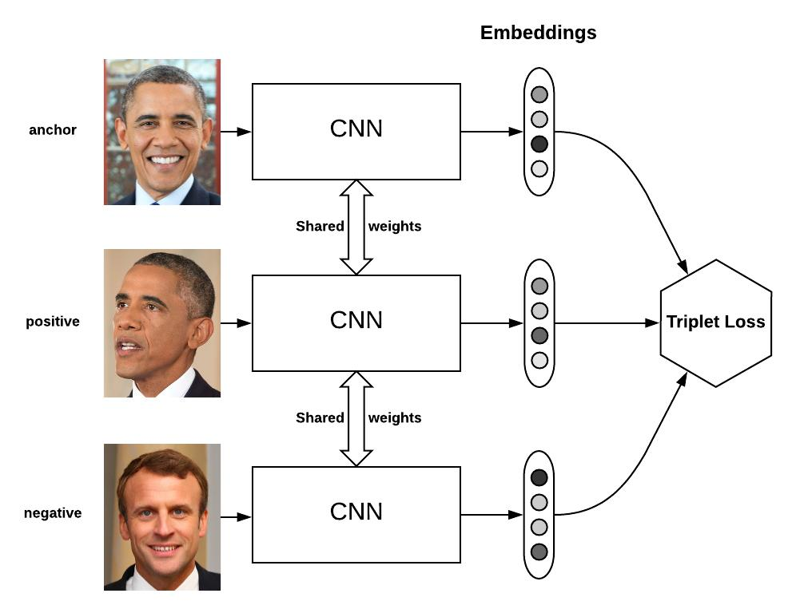

今天，我们很自然地会把一张图片、一段文字，甚至一份文档输入模型，得到一个向量，再用向量之间的距离衡量它们是否相似。

这个过程看起来很简单，却藏着一个关键问题：**为什么一串数字能够代表一个对象的特征？又是谁让这些数字之间的距离有了意义？**

要理解图像 Embedding 的发展，可以沿着两条研究路线往回看：一条从**图像分类**出发，发现神经网络的中间层可以提供通用特征；另一条从**相似度判断**出发，直接训练模型学习对象之间的距离。它们并不是严格的前后继承关系，而是在不同任务中逐渐走向了同一个思想。

>Embedding 并不是伴随现代深度图像分类模型才出现的概念。早在 20 世纪 80 年代，研究者就已经在探索如何通过神经网络学习概念的分布式表示。此后，LSA 和神经语言模型逐步推动了词语与文档的向量表示研究。2013 年，Word2Vec 的出现进一步促进了 Embedding 技术的广泛应用。
>
>与此同时，计算机视觉领域沿着两条相关路线发展：一条探索如何利用分类网络提取通用视觉特征，另一条探索如何学习样本之间的相似度。本文主要关注后两条路线如何逐渐发展出专门训练视觉 Embedding 的方法。

# 从图像分类说起：模型学会了什么？

2012 年，AlexNet 在 ImageNet 大规模视觉识别挑战赛（ILSVRC）中取得突破性成绩，成为深度卷积神经网络发展的重要标志。[《ImageNet Classification with Deep Convolutional Neural Networks》](https://papers.nips.cc/paper_files/paper/2012/hash/c399862d3b9d6b76c8436e924a68c45b-Abstract.html) 展示了一个深度 CNN 如何将图片分到 1,000 个预先定义的类别中。

例如，给模型输入一张金毛犬的照片，它可以输出“金毛犬”。但这也引出了一个问题：**模型只学会了输出类别名称吗？**

为了认出金毛犬，模型可能需要逐层捕捉边缘、颜色、纹理、局部结构乃至更高层的语义模式。这些信息不可能只存在于最后那个类别标签里；在作出分类之前，网络的中间层已经计算出了丰富的特征。

另一方面，现实中的对象和任务很难被一次性列举成固定的类别。例如，两张此前从未见过的人脸是否属于同一人？两张不属于训练集任何类别的图片是否相似？对于这些问题，直接增加分类标签未必是最合适的办法。

于是，一个自然的想法出现了：**能不能不使用最后的分类结果，而直接利用模型已经学到的中间层特征？**

# 分类网络的中间层，能否成为通用的表示？

以 AlexNet 为例，它的主体结构可以简化为：

```text
输入图像（RGB）
      │
      ▼
  Conv1 ～ Conv5        ← 逐层提取图像特征
      │
      ▼
 Flatten（9216）
      │
      ▼
   FC6（4096）          ← 可用作图像特征
      │
      ▼
   FC7（4096）          ← 可用作更高层的图像特征
      │
      ▼
   FC8（1000）          ← 对 1000 个类别输出 logits
      │
      ▼
    Softmax             ← 转换为类别概率
```

其中，`FC` 是 *Fully Connected*（全连接层）的缩写；`FC6`、`FC7` 和 `FC8` 是 AlexNet 的具体层名。实际网络还包含激活、池化、归一化等操作，上图只保留理解本节所需的主干。

`FC8` 为分类服务，而 `FC6`、`FC7` 输出的高维向量包含了对图像的某种表示。研究者发现，这些向量可以被取出来，作为其他任务的输入。

两篇具有代表性的论文是：

- [《DeCAF: A Deep Convolutional Activation Feature for Generic Visual Recognition》](https://arxiv.org/abs/1310.1531)：它研究如何复用在已有分类任务上训练出的卷积网络特征，并将这些特征迁移到新任务中。
- [《CNN Features Off-the-Shelf: An Astounding Baseline for Recognition》](https://arxiv.org/abs/1403.6382)：它进一步展示了预训练 CNN 特征在多种视觉识别任务中的实用价值。

这两项研究传递了一个重要信息：**分类训练的价值，不只在于训练出一个分类器，还在于得到可以被其他任务复用的特征表示。**


$$
\mathbf{z} = f_{\theta}(x), \qquad \mathbf{z} \in \mathbb{R}^{d}
$$
其中，`x` 是输入图片，`fθ` 是特征提取网络，`z` 是得到的向量。这个向量可以称为图像的 *representation*（表示）或 *embedding*（嵌入表示），具体称呼取决于上下文。

但这里需要区分两件事：**从分类模型里取出一个向量，并不意味着这个向量天然适合做精确的相似度比较。** 分类任务只要求类别能够被区分，并不直接保证向量距离符合我们希望的“相似关系”。

如果希望距离本身可靠，就需要另一条研究路线。

# 另一条更早的路线：孪生网络与相似度判断

这条路线可以追溯到 AlexNet 之前很久。

1993 年，Bromley 等人在[《Signature Verification using a “Siamese” Time Delay Neural Network》](https://papers.neurips.cc/paper_files/paper/1993/hash/288cc0ff022877bd3df94bc9360b9c5d-Abstract.html) 中研究签名验证：给定两份签名，如何判断它们是否来自同一个人？论文处理的是通过数位板采集的签名数据，而不是今天常见的两张静态人脸照片。

它所采用的思路可以抽象成一个**孪生网络（Siamese Network）**：让两个输入经过**共享参数**的特征提取网络，再比较得到的表示。



这里的“孪生”是指两个分支**使用同一套模型参数**。两个分支可以看作同一个编码器被调用了两次。

它和普通分类模型的任务不同：

- **分类**：这张图片属于哪个已知类别？
- **验证**：这两张图片是否属于同一个对象？

验证任务的特点是：即便训练时没有见过某个人，也希望模型能依据学到的表示判断两张新照片是否属于同一人。

**关键变化是：模型不必记住所有人的身份，而是要学会如何比较两个人脸。**

# 如何让“距离”真正表示相似？

只有孪生结构还不够。两个网络虽然共享参数，但如果训练目标不合适，它们输出的向量距离仍然可能没有我们想要的意义。

这就涉及**度量学习（Metric Learning）**：学习一种表示或距离函数，使相似对象在表示空间中更接近，不相似对象更远离。

2005 年，Chopra、Hadsell 和 LeCun 在[《Learning a Similarity Metric Discriminatively, with Application to Face Verification》](https://doi.org/10.1109/CVPR.2005.202) 中研究了通过人脸样本对学习相似度的方法。2006 年，Hadsell 等人在[《Dimensionality Reduction by Learning an Invariant Mapping》](https://doi.org/10.1109/CVPR.2006.100) 中进一步系统地研究了基于相似与不相似样本对的训练目标。

可以将其直观地理解为：

- 输入**正样本对**：同一个人的两张照片，希望两个向量靠近。
- 输入**负样本对**：不同人的两张照片，希望两个向量至少保持一定距离。

这种通过比较样本之间的关系来学习表示的方式，体现了**对比学习（Contrastive Learning）**的核心思想。早期研究通常利用人工标注的正负样本关系进行监督训练，后来逐渐发展出不依赖人工类别标签的自监督对比学习方法。

# 从“孪生问题”到“双胞胎问题”：为什么需要三元组？

现在把任务再提高一点难度。

假设有三张照片：两张是张三，另一张是张三的双胞胎兄弟李四。我们希望模型不仅能说出哪些照片属于同一个人，还能在非常相似的两个人之间找出关键区别。

这里把它形象地叫作“**双胞胎问题**”。但要注意：这是本文为了叙事使用的比喻，**不是一个公认的独立学术问题名称**。它对应的技术挑战之一，是*困难负样本（Hard Negative）*：负样本明明属于不同对象，却与锚点非常相似，因而很容易被模型误判。

如果模型只见过特别容易区分的正负样本，它可能很快学会“距离远近”，却未必有能力处理这些细微差异。

于是，训练时可以不再只问“两张图片是否相似”，而是提出一个更明确的问题：

> **相对于同一个参照物，哪一张图片应该更近？**

这就是三元组（Triplet）的直观思想。一次提供三张图片：

- **Anchor（锚点）**：作为参照的图片。
- **Positive（正样本）**：与锚点语义上应该更接近的图片。
- **Negative（负样本）**：与锚点应该更远的图片。

三张图片进入**共享参数的同一个编码器**，产生三个向量，并要求：

$$
d(a,p)+m\leq d(a,n)
$$

其中，`d(a,p)` 表示锚点与正样本的距离，`d(a,n)` 表示锚点与负样本的距离，`m` 是希望保留的安全间隔（margin）。一种常见的三元组损失写法是：

$$
L_{\mathrm{triplet}}=\max\left(0,\;d(a,p)-d(a,n)+m\right)
$$

如果正样本已经比负样本近得足够多，损失就是 0；反之，模型就会通过训练调整向量的位置。



*图：三元组训练的概念示意图。图中负样本代表不同身份，但不一定就是困难负样本；是否“困难”取决于当前模型对它的相似度判断。本图用于解释机制，并非下述论文的原始网络结构图。*

2014 年，[《Learning Fine-grained Image Similarity with Deep Ranking》](https://openaccess.thecvf.com/content_cvpr_2014/html/Wang_Learning_Fine-grained_Image_2014_CVPR_paper.html) 用深度网络和三元组排序目标研究细粒度图像相似度。它关注的不仅是“同类还是不同类”，更是相对于查询图片，哪一张结果**更相似**。这篇论文是深度三元组排序的代表性工作，但并不意味着三元组思想在这一年才首次出现。

2015 年，[《FaceNet: A Unified Embedding for Face Recognition and Clustering》](https://openaccess.thecvf.com/content_cvpr_2015/html/Schroff_FaceNet_A_Unified_2015_CVPR_paper.html) 则将直接优化人脸 Embedding 与三元组训练紧密结合，展示了同一套向量表示用于人脸验证、识别和聚类的能力。

至此，我们可以看到两个阶段的区别：**早期是在“已有分类特征上使用向量”；这里则进一步要求模型“直接学出适合比较距离的向量”。**

# 结语

回过头来看，从最开始的图像分类，到后来利用 CNN 提取特征，再到通过对比学习、三元组学习直接训练 Embedding，其实一直在解决一个问题：**如何让模型学到更有用的表示。**

只不过，最开始我们更关心模型能不能正确分类，后来逐渐开始关注模型学到了什么，以及这些特征能不能用来比较不同对象之间的关系。

这也就解释了为什么今天我们可以把一张图片、一段文字转换成向量，再通过向量之间的距离来判断它们是否相似。
